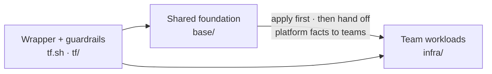

# terraform-template

Portable **base + infra** Terraform starter (cloud-neutral `terraform_data` scaffold). Sample teams `teama` / `teamb` — rename dirs and run `./tf.sh conf -g` when you fork.



Shared and team layers use **separate state**. Platform context reaches teams through **checked-in config**, not `terraform_remote_state`. Sample `.tf` is placeholder until you wire your cloud; secrets stay in gitignored `.env`.

```
base/<scope>/          one state per scope (e.g. platform, permissions)
infra/<team>/          team .tf + config/<env>/ (*.auto.tfvars, backend.hcl)
tf.sh                  entrypoint wrapper
tf/                    wrapper, policies, linters, infracost catalogue
```

## Commands

```bash
./tf.sh conf
./tf.sh b platform init
./tf.sh i teama staging plan -refresh=false
./tf.sh -i              # menu (fzf)
```

| Pattern | Meaning |
|---------|---------|
| `b <scope> <cmd>` | shared stack under `base/` |
| `i <team> <env> <cmd>` | team stack + env tfvars |

## Tooling

```bash
tfenv install && tflint --init --config=tf/.tflint.hcl
pre-commit install --hook-type pre-commit --hook-type pre-push
```

**Pre-push:** Checkov only. **Infracost** is registered but **not** on push — run when you want: `pre-commit run infracost_breakdown --hook-stage manual` (or `./tf/pre-commit-infracost.sh`).

Tooling configs live under `tf/`; optional root `infracost.yml` → `tf/infracost.yml` symlink.

**Deeper setup** (pre-commit, tflint OPA, tfpolicy, checkov, infracost): see the Terraform on Azure book on Leanpub — **<https://leanpub.com/terraform-on-azure>**.

## HashiCorp Terraform Agent Skills

Optional [Agent Skills](https://github.com/hashicorp/agent-skills/tree/main/plugins/terraform/skills) for coding assistants — install the plugin, then enable skills as needed:

| Skill | Use with this repo |
|-------|-------------------|
| **terraform-policy** | Author and test `tf/tfpolicy` (`.policy.hcl`, `policytest`) |
| **terraform-test** | Native `.tftest.hcl` on `base/modules` and `infra/modules` |
| **refactor-module** | Split stacks, `moved` blocks, safer state shape |
| **terraform-style-guide** | Consistent HCL layout and naming |
| **terraform-search-import** | Import and adopt existing resources |

Also in the catalog: **terraform-stacks**, **azure-verified-modules** (Azure), and **provider-*** skills when you work on custom providers — not required for the default scaffold.
