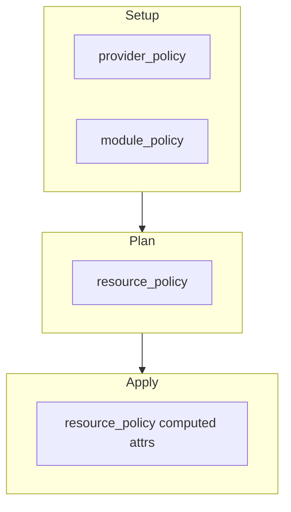

# Terraform Policy (`tfpolicy`)

One **enforced** example per policy kind (cloud-neutral). **Kind** decides what to evaluate; **Setup / Plan / Apply** follow from the data each rule uses — not a custom `stage` field.

| Kind | Typical phase | Reads | This repo |
|------|----------------|-------|-----------|
| `provider_policy` | Setup | `meta.*` | [`provider_hashicorp_registry.policy.hcl`](policies/provider_hashicorp_registry.policy.hcl) |
| `module_policy` | Setup | `meta.*` | [`module_source_local.policy.hcl`](policies/module_source_local.policy.hcl) |
| `resource_policy` | Plan (also Apply when attrs are post-create) | `attrs.*` | [`terraform_data_input.policy.hcl`](policies/terraform_data_input.policy.hcl) |



Apply checks attributes known **after this run** — not live Portal drift. `policytest` mocks use `meta` for provider/module cases and `attrs` for resources.

```bash
brew tap hashicorp/tap && brew install hashicorp/tap/tfpolicy
./tf/run-tfpolicy.sh validate
./tf/run-tfpolicy.sh test
```

Each enforced file has a matching `tests/*.policytest.hcl`. Pre-commit runs `test` when `tfpolicy` is on PATH. [Policy docs](https://developer.hashicorp.com/terraform/policy).
